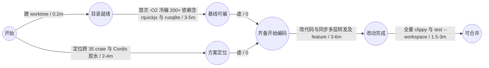

# Mizar 评测深度审计与 v0.3 分波重构计划

> **状态**：Wave 0、Wave 1（`109ab2f`）、Wave 2-A（`b367720`）、`W2-4`（`bc7480d`）、`W2-5 Step 1`（`2ebbce5`）、`W2-5 Step 2`（`99506c0`）与 `W2-5 Step 3`（`26e9a4c`，彻底退出 `cordis` 并稳定于 **10 Crates**；全量 CI 34 suites · 424 passed / 0 failed / 0 ignored / 0 warnings）全部 **12 项重构包**已合入 `main`；待运行 FrontierHarness A/B 对照评测与最终验收收尾  
> **适用范围**：Mizar Rust Core（`mizar-llm-*` / `mizar-agent-loop` / `mizar-compaction` / `mizar-tools*` / `mizar-recall` / `mizar-skills` / `mizar-mcp` / `mizar-system-prompt` / `mizar-agent-spine` / `mizar-cache-warming` / `cordis`）与客户端层（`mizar-client*` / `mizar-tui*`）  
> **证据来源**：FrontierHarness 15 题评测日志（`codex@0.164.0` / `pi@1.4.0` / `mizar@0.1.6` / `mizar@0.2.0`）、Mizar 源码与 35-crate 量化实测（2026-11-23，总计 103,208 LOC，其中 `src/` 72,014 行、测试 31,194 行）、[hooks-cache-and-subagent.md](hooks-cache-and-subagent.md) 第八节对照审计、Herdr `mizar` 空间 Tab 3 静态审计、以及 `references/`（`pi` / `omp` / `dim` / `deepseek-harness` / `dsh-TUI` / `dsh-ops` / `maka` / `obelisk` / `billion-context`）对标调研。

---

## 一、FrontierHarness 评测实证与问题定位

### 1.1 四端对比基线（13 题共同完成集）

统一评测条件：`isok/gpt-6.2-sol`，`reasoning.effort=high`，`max_output_tokens=131072`，Sol 定价基准 `$2 / $0.10 / $10`（Input / Cached / Output per 1M tokens）。

| Harness | 通过率（13 题共同集） | 总 Turns | Tools / Turn | 工具分布 | Total Input (Cached%) | Total Output (Reasoning) | `brk80`（Cache 断裂次数） | 平均耗时 | TTFT（rsn>100） | 总成本（单 Pass） |
| :--- | :--- | :--- | :--- | :--- | :--- | :--- | :--- | :--- | :--- | :--- |
| **`codex@0.164.0`** | **12/13 (92.3%)** | **159** | **2.09**（**48.6%** 并行，max 12） | — | **4.35M** (86.5%) | 146.7k (61k) | 9 | 277s | 3.64s (**2.66s**) | `$3.02` (`$0.252/pass`) |
| **`pi@1.4.0`** | **12/13 (92.3%)**（含 freecad 12/14） | 273 | 0.95（0% 并行） | `bash 127, read 88, edit 50, write 16`（`read/edit/write` 0% err） | 4.74M (90.5%) | **118.1k** (48.7k) | **6** | **249s** | **2.21s** (**2.14s**) | **`$2.51`** (`$0.210/pass`) |
| **`mizar@0.1.6`** | 11/13 (84.6%，含 freecad 11/14) | 287 | 0.95（0% 并行） | `bash 241 (71%), edit 66, read 16 (4.7%), write 15, grep 0, find 0, tool_search 1` | 6.21M (89.9%) | 150.0k (69.6k) | **25** | 295s | 4.91s (**11.31s**) | `$3.31` |
| **`mizar@0.2.0`** | 7/13 (53.8%，含 freecad 7/14) | 300 | 0.96（0% 并行） | `bash 223 (68%), edit 66, write 25 (+67%), read 13 (4%), grep 0, find 0, tool_search 1, recall_search 1` | 6.74M (90.5%) | 168.4k (84.7k, 50.3%) | 17 | 344s | 5.49s (**11.32s**, P95 14.9s) | `$3.58` |

> **注**：`vpp-loss-divergence` 因宿主机 `/var/lib/containerd` 磁盘写满在四端均失败；`codex` 的 `freecad-impeller` 因 `apt-get` GPG 校验失败、`roy-polymorph-cn` 未通过；`mizar@0.2.0` 的 `polyglot-rust-c` 遭遇容器验证基建事故（`rustc -o /dev/null` 破坏 `/dev/null` 权限且容器缺少 `curl`），其余 3 题失败（`mvcc-lsm-compaction` / `batched-eval-parity` / `wal-recovery-ordering`）属于单次 `attempts=1` 在高难任务上的方差。实测 `v0.1.6` 与 `v0.2.0` 在无头 `mizar exec --isolated --no-persist` 下 Turn-0 线格式与工具列表（`tool_count=8`）字节级一致。

### 1.2 评测暴露的 8 大核心短板（含法医级轨迹对比新发现）

1. **工具并行度为 0%**：`codex` 平均每轮 2.09 个工具调用（48.6% 并行），总 Turn 数仅 159；Mizar（0.95–0.96）与 `pi`（0.95）每轮只调 1 个工具，Turn 数接近翻倍、输入 token 累计高出 40%–55%。
2. **重度 `bash` 依赖与盲写**：Mizar 68%–71% 工具调用是 `bash`（`cat`/`sed`/`grep`/`find` 全靠 shell），`read` 仅 4%–4.7%，`grep`/`find` **0 次调用**；`v0.2.0` 整文件 `write` 增至 25 次（较 `v0.1.6` +67%）。且 `edit` 缺 Pi 式 `edits[]` 多段原子替换（Pi 全 15 题 50 次 `edit` 0 错误、仅 16 次 `write`）。
3. **推理首字延迟（TTFT）异常**：有推理输出时，Mizar 平均 TTFT 高达 **11.3s**（P95 14.9s），而同模型下 `pi` 仅 **2.14s**、`codex` 仅 **2.66s**。
4. **Prompt Cache 稳定性隐患**：顶层 `body["instructions"]` 不被 GPT-6.2 纳入前缀缓存，`tools` 注册表又会因延迟工具激活在中途突变，放大 `brk80`（Cache 大幅重算次数：Mizar 17–25 vs Pi 6）。
5. **15 次 `IN_DROP` 缓存坍塌（Mizar 15 次 vs Pi 0 次 / Codex 1 次）**：全量非首步请求对照显示，Pi 281 步 `hit>=80%` 达 93.6%、`IN_DROP = 0`；Mizar 0.1.6 / 0.2.0 分别出现 **7 次 / 8 次**输入骤降 3k–8k token 且缓存命中率摔至 0.10–0.56（如 `batched-eval-parity s38` 跌至 `6016/56692 = 0.11`）。Mizar 已发 `prompt_cache_key` 与亲和头，实锤根因是 `B-4` 重排多段 `reasoningItems` 并丢弃 assistant `output_text[]`/`id`/`phase`/`status`，直接触发服务端前缀失配与推理缓存驱逐。
6. **`bash` 工具耗时黑洞**：对比 `wall_time - llm_time`（纯工具壁钟耗时），`freecad-impeller` 上 Mizar 0.2.0 达 **295.0s**（Pi `12.3s`），`schemelike-metacircular-eval` 达 **211.1s**（Codex `33.0s` / Pi `64.8s`），归因于 `bash` 无默认超时（单步卡至 60s–95.1s）与 `Sequential` 串行锁死。
7. **提前自信交卷与现行 Prompt 过简**：Mizar 0.2.0 4 道非基建失败题（含 `embedding-drift-monitor` 0.1.6/0.2.0 两次全挂，而 Codex/Pi 两次全过）均以 `reason: "completed"` 提前交卷；核查源码发现 Mizar 无头 `exec` 现行完整 System Prompt 仅 14 行、中英混杂且开篇是通用聊天人设（`"你是一个乐于助人的 AI 助手"`），缺乏工具分工、退出码检查与验证底线。
8. **无头模式诊断黑盒**：`mizar exec --isolated` 退出或超时后丢弃完整 `TrajectoryReport`，缺少可落盘的结构化 `trajectory.json` 导出。

---

## 二、已锁定的 13 项核心产品与架构决策

在进入改造前，已与主人逐项拍板并锁定以下 13 项边界决策：

| 编号 | 决策主题 | 锁定方案 |
| :--- | :--- | :--- |
| **D1** | 默认编码工具集 | 保留 **6 个核心编码工具（`read` / `edit` / `write` / `bash` / `grep` / `find`）**，升级 `grep` 与 `find`；Wave 1 **不引入 `apply_patch` 与 `hashline`**。 |
| **D2** | Recall 与工具表冻结 | 将 `recall_search` + `recall_read` 合并为 **1 个极简常驻静态 `recall` 工具**（借鉴 `dim`）；会话运行期间**绝不动态增删 `tools` 列表**；`tool_search` 仅在存在外部 MCP `Deferred`/`Codemode` 工具时启用（0 MCP 时隐藏）；0 skills 时隐藏 `skill` 工具 → 常规 0-MCP/0-Skill 无头评测固定为 **7 个工具**。 |
| **D3** | System Prompt 骨架与工程原则分层 | 无头静态 System Prompt 控制在 **~1.8KB 纯英文**（按 `order` 分 4 段）： 1) `order=0` `persona`：Coding Agent 身份 + 语言跟随 + **2 句克制版验证/退出码/事实底线**（借鉴 DSH + Codex）+ **4 句工程原则**（最简单模块化与长远结构决策、先查现有依赖与成熟模式、分层最小端到端生长、不破坏任务/既有契约前提下清理死代码不留 shim）； 2) `order=20` `tools_guide`：按已声明工具动态拼 1 工具 1 句边界（含 `edit` `edits[]` 与反 `bash` 搜读禁令）+ 2 句清晰并行 Batching 指导； 3) `order=40` `runtime_protocol`：静态标签协议说明，动态内容（`AGENTS.md`/skills/MCP 动态列表/cwd）全部退出 System Prompt 走消息通道，静态前缀 100% 字节冻结； 4) `order=60` 隔离增量段：`subagent`（仅开启时）与 `tui_reply_guidance`（**仅交互式 TUI 启动时**，`≤800B`，承载「多步工作期间向用户简短说明进度」原则）。 |
| **D4** | TUI 提示词严格隔离 | **仅在启动交互式 TUI 时才拼装 TUI 提示词**，严禁混入 `mizar-agent-spine` 公共层、`mizar exec` 无头模式或 `subagent`。 |
| **D5** | 工具截断、写保护、`edit` `edits[]` 与 `bash` 超时/并发 | `bash` 内联截断收紧至 **`16–20KB / 400 lines`** + `head+tail` 中间省略 + `768B` 最大行宽（完整输出仍落临时文件），增加**默认超时 `120s`（参数可扩至 `600s`）**，执行模式放开 **`ToolExecutionMode::Parallel`**（由提示词约束仅无依赖时并发）；修改**已存在且超过 50 行**的文件前必须本会话至少 `read` 过一次（新建与 `edit` 放行）；`read` 输出带 `<line>\t<text>` 行号；`edit` 升级为 **Pi 式多段原子 `edits[]`**（相对原文件匹配、校验不重叠、紧凑限长 diff + 失败近邻预览）并支持 `replaceAll`；`edit`/`write` 改 `Parallel`（复用 per-path `with_file_mutation_queue`）。 |
| **D6** | 上下文压缩极简瘦身 | `mizar-compaction` 从 **2,896 LOC（不含测试）/ 18 旋钮 / 4 层 4 触发器** 砍成 **1 套单阶段检查点主路径**；彻底删除 **L1 `pruner.rs`、`ColdCache` 空闲触发、`Re-plan` 二次硬切、L4 `read-dedup`** 及 `mizar-cache-warming` 对 `compaction` 的 feature 耦合，**不留向后兼容层**。 |
| **D7** | 自动压缩时机与 80% 阈值 | 对标 Pi（`window - 16k`）、DSH（`80%`）与 DST（主 `cordis.yml` 的 `0.2` 仅为适配 DeepSeek 1M 窗口的 TUI 覆写，`liangshen` preset 仍走 `80%`），明确**不设硬编码 `200k`/`380k` 软顶**（`max_context_tokens: Option<u64>` 默认 `None`）；自动触发锁定在模型真实可用窗口 `usable = context_window - reserved_output` 的 **`80%`**（128k→~89k，200k→~147k，1M / 131k max_out→~734k）；时机采用 **`agent/pre-step` 步前检查 + `agent/request-error` 溢出强压重试（`retain = 0`）+ TUI 手动 `/compact [focus]`**（后续可按需挂小窗模型切换前压缩）；压后保留固定 `keep_recent_tokens = 20_000`（小窗自动钳位 `effective_window / 4`）。 |
| **D8** | 缓存保活退场与分波推进 | **Wave 2 彻底删除 `mizar-cache-warming` 主动后台重放器**，仅将轻量的被动 Cache Re-billed 审计迁入 `mizar-types`（现 `mizar-llm-types`）；整体按 **W0（Worktree 构建提速前置）→ Wave 1（Eval 主路径 Bug + 压缩瘦身 + 工具升级 + Prompt 重组 → 多 attempt Eval A/B 验证）→ Wave 2（性能/安全修复 + Crate 拍扁与深层结构去债）** 推进。 |
| **D9** | TUI vs CLI 无头组件分层 | 收敛为「共享无头内核 + TUI 独占增量层」：**`codemode` 两端保留**（0 `Codemode` 工具时自动保持未激活、零 schema 开销）；`session-title` 移出无头默认脊柱归属 TUI/交互端；`tui-emphasis`、`approval-gate`、`local-bash` 及侧栏/剪贴板等终端扩展仅 TUI 装配。 |
| **D10** | `subagent` 与 `@file` 策略 | **`subagent` 在交互式 TUI 开启、CLI 无头模式（`mizar exec`）默认关闭**；**`@file`（`FileMentionsPlugin`，位于 `crates/mizar-client/src/mentions.rs`）作为两端共享能力**，在 `mizar exec` 与 TUI 均默认启用展开 `@path` 文件上下文。 |
| **D11** | Responses 高阶能力分波 | `supports_strict_mode`（按模型兼容开启 `strict: true` 约束采样，减少畸形 tool JSON）纳入 **Wave 1 (`W1-1`)**；`configuration_update`（TUI 中途切换思考强度不破缓存）与 `additional_tools`（动态加载外部 MCP 工具不破缓存）纳入 **Wave 2 (`W2-2`)**。 |
| **D12** | `rg`/`fd` 安装托管与离线兜底 | `scripts/install.sh` 安装期先检测系统是否已有 `rg` 和 `fd`（兼容识别 `fdfind`），已存在则不碰用户环境；缺失时下载官方预编译静态包（`BurntSushi/ripgrep`、`sharkdp/fd`，走 `/releases/latest` 302 避开 API 限流，Linux 优先 `musl`）解压到私有目录 **`~/.mizar/bin/`**（支持 `--skip-tools` / `MIZAR_SKIP_TOOLS=1`，离线/失败仅警告不阻断安装）。运行期 `grep`/`find` 按 **用户 `PATH`（含 `fdfind`）→ `~/.mizar/bin/` → 同源 Rust `ignore` 离线兜底**（`grep` 补基于既有 `ignore` + `regex` 的纯 Rust 兜底）；`bash` 在 `~/.mizar/bin` 存在时将其**追加到 `PATH` 末尾**。 |
| **D13** | 深层偶然复杂度治理与留守 Rust 边界 | **明确留在 Rust 不整库重写 Go**：FrontierHarness 评测 8 大短板 0 个由 Rust 语言导致，隔壁 `Merak` 桌面端已是基于 Rust + GPUI + `cordis` 构建，且 Go 在富终端 TUI（`bubbletea` vs `ratatui`）与异步 JS 沙箱（`goja` vs `rquickjs`）上存在明显能力回退（仅当未来产品战略彻底放弃重终端 TUI 与 `rquickjs`、且 Merak 全面改走 JSON-RPC Sidecar 时才重新评估）。针对此前 [hooks-cache-and-subagent.md](hooks-cache-and-subagent.md#L180-L209) 放过的架构与构建层偶然复杂度，正式纳入：**W0 构建缓存提速（`sccache` + 定向 `-p` 验证纪律）**，以及 Wave 2 的 **`W2-4`（35 → 10–11 个粗粒度 crate + 清理 `legacy`）** 与 **`W2-5`（分三步退出 `cordis` / `SpinePlugins` / 17 字符串事件 / `cordis::Logger`）**，严守不与 Wave 1 Eval 主线混做的隔离红线。 |

### 2.1 TUI vs CLI 无头（`mizar exec`）组件装配分层表

| 组件 / 模块 | CLI 无头模式（`mizar exec`） | 交互式 TUI | 说明 |
| :--- | :--- | :--- | :--- |
| **核心 6 工具（`read`/`edit`/`write`/`bash`/`grep`/`find`）** | 装配 | 装配 | 共享最小完备编码底座 |
| **`compaction` + 静态单一 `recall`** | 装配 | 装配 | `80%` 真实可用窗口触发 + 固定 `20k` 保留尾巴 + 历史可回溯 |
| **`instructions`（`AGENTS.md`）** | 装配（支持 `--no-instructions`） | 装配 | 两端一致遵守项目规范 |
| **`codemode`** | **保留装配** | **保留装配** | 仅在存在 `ToolExposure::Codemode` 工具时自动激活，0 MCP 时零开销 |
| **`@file`（`FileMentionsPlugin`）** | **装配** | **装配** | 从 TUI 专属下沉至两端共享输入层，无头亦可直接展开 `@path` |
| **`repeat-guard` / `trajectory`** | 装配 | 装配 | 无头防死循环并支持 `--trace-out` 导出；TUI 驱动时间线视图 |
| **`skills` / `mcp` + `tool-search`** | 按需（0 项时零工具注入，`--isolated` 跳全局） | 按需 | 冻结会话内 `tools` 声明，避免中途突变打穿 KV Cache |
| **`subagent`** | **默认关闭** | 装配 | 无头一次性任务默认单主链执行，不开启异步分身 |
| **`session-title`** | **不装配** | 装配 | 移出无头默认脊柱，仅交互式会话需要自动生成标题 |
| **`tui-emphasis`（`reply_guidance_prompt`）** | **严禁装配** | 装配（`≤800B`） | 仅在启动交互式 TUI 时拼装，绝不进入 `exec` / `spine` / `subagent` |
| **交互扩展（`approval-gate`/`local-bash`/`side-panel`/剪贴板等）** | 不装配 | 装配 | 强依赖终端交互界面与快捷键 |
| **`cache-warming` 后台重放器** | **移除（Wave 2）** | **移除（Wave 2）** | Wave 2 删除主动保活，仅留被动 Cache Re-billed 审计进 `mizar-llm-types` |

---

## 三、问题分类总清单：代码 Bug vs 提示词重组

### 3.1 代码 Bug 清单

#### A. Wave 1 Eval 关键路径与核心正确性 Bug

- **B-1（核弹级）Responses API `instructions` 不进 Prompt Cache + Router 丢 Compat 字段**
  - **位置**：[crates/mizar-llm-responses/src/lib.rs#L256-L286](../../crates/mizar-llm-responses/src/lib.rs#L256-L286)、[crates/mizar-llm-router/src/lib.rs#L381-L405](../../crates/mizar-llm-router/src/lib.rs#L381-L405)、[crates/mizar-llm-router/src/config.rs#L68](../../crates/mizar-llm-router/src/config.rs#L68)
  - **现象**：`build_request_body` 将 System Prompt 拼入顶层 `body["instructions"]`，同时 `build_protocol_adapter` 对 `ProtocolKind::OpenaiResponses` 丢弃了 `CompatConfig.supports_developer_role`。参照 `omp` 实证注释（`openai-responses.ts:1877-1885`），GPT-6.2 对顶层 `instructions` 不做 KV Cache 命中，必须将系统指令作为 `role: "developer"` 内联放进 `input` 首位（或按 `supports_developer_role` 控制）。**必须在扩充 System Prompt 前修复。**

- **B-2（TTFT 飙升 11.3s + 日志 `ttft_ms: null`）**
  - **位置**：[crates/mizar-llm-responses/src/lib.rs#L308-L311](../../crates/mizar-llm-responses/src/lib.rs#L308-L311)、[crates/mizar-agent-loop/src/lib.rs#L935-L992](../../crates/mizar-agent-loop/src/lib.rs#L935-L992)
  - **现象**：`body["reasoning"]` 仅发送 `{"effort": effort}` 而漏发 `"summary": "auto"`，导致 OpenAI Responses 推理摘要流延迟到达甚至整段推理期无首包，TTFT 从 Pi 的 2.14s 恶化至 11.32s；此外 `AgentLoop` 仅在 `TextDelta`/`ReasoningDelta` 时发送 `FirstToken` 事件，忽略 `ToolCallDelta`，导致直出工具调用轮的 `ttft_ms` 记为 `null`。

- **B-3（延迟工具激活炸穿 KV Cache + 空目录冗余工具）**
  - **位置**：[crates/mizar-recall/src/lib.rs#L440](../../crates/mizar-recall/src/lib.rs#L440)、[L632](../../crates/mizar-recall/src/lib.rs#L632)、[crates/mizar-tool-search/src/lib.rs#L39](../../crates/mizar-tool-search/src/lib.rs#L39)、[crates/mizar-skills/src/plugin.rs#L260](../../crates/mizar-skills/src/plugin.rs#L260)
  - **现象**：`recall_search` / `recall_read` 默认设为 `ToolExposure::Deferred`，触发 `tool_search` 在 0 MCP 时自动注入；一旦会话中途激活，顶层 `body["tools"]` 数组从 8 个变成 10 个，直接打穿全量 Prompt Cache；此外 0 skills 时 `skill` 工具仍被注册为 `ToolExposure::Direct`。

- **B-4（P0 核弹级，与 B-1 同级 — 15 次 `IN_DROP` 缓存坍塌元凶：Responses 多段输出重排与元数据丢失）**
  - **位置**：[crates/mizar-llm-responses/src/lib.rs#L105-L128](../../crates/mizar-llm-responses/src/lib.rs#L105-L128)、[L593-L649](../../crates/mizar-llm-responses/src/lib.rs#L593-L649)（对照 Pi：[openai-responses-shared.ts#L334-L360](../../references/pi/packages/ai/src/api/openai-responses-shared.ts#L334-L360)）
  - **现象**：流式组装器合并 reasoning/text 槽位，并在回放时将所有 `reasoningItems` 统一挪到文本与 `function_call` 之前，同时丢弃 `message.id`、`phase`、`status` 与 `output_text[]` 结构；一旦单步包含多段交替 `reasoning + message + toolCall`，回放序列与上游已缓存前缀直接错位，诱发服务端推理前缀驱逐（评测实测 Mizar 出现 15 次 `IN_DROP` 缓存骤降，Pi 为 0 次）。

- **B-5（`mizar-compaction` 6 连坑，致使压缩机制基本不可用）**
  1. **漏算 `cache_read` 导致用量低估 20×**：[budget.rs#L206-L211](../../crates/mizar-compaction/src/budget.rs#L206-L211) 用净 `u.input_tokens` 作校准锚点，而不是 [types.rs#L523](../../crates/mizar-llm-types/src/types.rs#L523) 已提供的 `u.prompt_tokens()`（已含 `cache_read_tokens` + `cache_write_tokens`）。在 95% 缓存命中下，实际 180k 上下文会被误判为 9k。
  2. **L1 Pruner 自己炸掉 L2 前缀缓存**：[service.rs#L390](../../crates/mizar-compaction/src/service.rs#L390) 先落盘 `append_prune` 修改历史前缀，随后又在 [service.rs#L549-L563](../../crates/mizar-compaction/src/service.rs#L549-L563) 开启 `reuse_prefix_cache: true`，导致 L2 摘要请求 100% cache miss。
  3. **摘要关闭思考发错格式 + 硬编码 `temperature: 0.2` 致 400**：[summarizer.rs#L164-L165](../../crates/mizar-compaction/src/summarizer.rs#L164-L165)、[L212-L213](../../crates/mizar-compaction/src/summarizer.rs#L212-L213) 硬编码 `temperature: Some(0.2)` 且 fallback 不清 `temperature`；同时 [mizar-llm-responses/src/lib.rs#L242](../../crates/mizar-llm-responses/src/lib.rs#L242) 把 `ReasoningEffort::Off` 映射成 `None`（不发 `reasoning.effort: "none"`），导致推理模型要嘛 400 报错、要嘛继续默认开启 `medium`/`high` 思考。
  4. **未知模型错借其它模型上下文窗口**：[service.rs#L105-L110](../../crates/mizar-compaction/src/service.rs#L105-L110) 当明确传入的 `model` 未命中时，使用 `.or_else(|| p.models.first())` 错误借用列表第一个模型的窗口与 `max_tokens`。
  5. **`usable_tokens` 与 `effective_window` 混算导致阈值倒挂**：[budget.rs#L47-L53](../../crates/mizar-compaction/src/budget.rs#L47-L53) 让 `trigger_tokens` 按 `effective_window`（380k）算，`post_compact_max_tokens`（~458k）和 `urgent_tokens`（~844k）却按 `usable_tokens`（~917k）算，互相劈叉。
  6. **Re-plan 静默丢失尾部上下文 + 提示词 `[seq #N]` 失配**：[service.rs#L618-L639](../../crates/mizar-compaction/src/service.rs#L618-L639) 在生成摘要后再缩小保留尾部却不重摘要多被切掉的消息；而 `run_prefix_reuse_summary` 要求模型基于 `seq #N` 切分，但 `derive_messages()` 发给模型的消息里并不含 `seq #N`。

- **B-6（工具运行期 Panic / 死锁 / OOM / 截断 / 缺失依赖 Bug）**
  - `mizar-skills/src/plugin.rs#L157-L183`：`extract_skill_gestures` 用 `bytes[end] as char` 判断空白再直接切片 `&text[start..end]`，中文/UTF-8 多字节里含 `0x85`/`0xA0` 时触发字节边界 panic。
  - `mizar-agent-loop/src/lib.rs#L1288-L1292`：畸形工具参数 JSON 通过 `.unwrap_or_else(|_| json!({}))` 静默吞成空对象；`mizar-llm-responses/src/lib.rs#L702-L716` 流异常结束时仍 emit `pending_calls`。
  - `mizar-tools-coding/src/bash.rs`：子进程无默认超时限制（单次命令可卡死数十秒）、输出在内存无界累积易 OOM、预览构造 O(N²)、继承父进程 `$SHELL` 与文件描述符导致后台进程挂起。
  - `mizar-tools-coding/src/read.rs`：缺少单行超长截断（单行 minified JSON 即可撑爆窗口）及边界逻辑缺陷。
  - `mizar-tools-coding/src/find.rs#L51,L86`：`stderr(Stdio::piped())` 未并发抽干与等待（超 64KB 死锁），且仅查 `fd` 未识别 Debian/Ubuntu `fdfind` 与 `~/.mizar/bin/fd`。
  - `mizar-tools-coding/src/grep.rs#L178`：环境缺失 `rg` 时无 `~/.mizar/bin` 回退与纯 Rust 兜底，直接报错失败。

- **B-7（工具扫描开销、MCP 前缀漂移与首轮上下文顺序）**
  - `mizar-tools-coding/src/lib.rs#L127`：调用 `tools.list_declared_infos(None)` 忽略 `session_id`（拿不到每会话状态）且在每步 pre-step 重复构建。
  - `mizar-mcp/src/lib.rs#L852`：连接 MCP 后用动态 `PromptSection` 插入系统提示词中段，污染静态前缀。
  - `instructions` / `skills` 在 pre-step 才追加 `SessionEvent::ContextNotice`，导致 Turn-0 消息顺序反置在 `environment_context` 之前。

- **B-8（无头 `exec` 轨迹丢失）**
  - `crates/mizar-tui/src/exec.rs`：`--isolated`、纯文本模式、错误或超时退出时直接丢弃完整 `TrajectoryReport`，缺 `--trace-out` / `MIZAR_TRACE_OUT` 无条件导出。

#### B. Wave 1 协议与重试 P1 缺陷
- `crates/mizar-tools-coding/src/edit.rs#L162`、`write.rs#L71` 与 `bash.rs#L338` 均锁死 `ToolExecutionMode::Sequential`（`edit`/`write` 已有 per-path 互斥队列却阻断跨文件并行，`bash` 串行亦放大多命令探测延迟）。
- `mizar-llm-responses`：[lib.rs#L322](../../crates/mizar-llm-responses/src/lib.rs#L322) 硬编码 `"strict": false`（放弃模型结构化约束采样）；`XHigh => "high"` 降档错误；`response.incomplete` 一律按 `MaxTokens` 归类；`max_output_tokens` 未按 OpenAI 要求钳位 `>=16`；`parse_usage` 漏解析 `cache_write`；`mizar-llm-retry` + `agent-loop` 对「只返回推理块、正文和工具调用皆空」的 `EmptyResponse` 不触发自动重试。

#### C. Wave 2 Tab 3 主线性能、安全与深层架构债
- `mizar-cache-warming`：阻塞休眠计时器失效、长会话历史滞留与内存泄漏。
- `mizar-session-sqlite`：主线程/Tokio worker 上同步写库、跨 50 会话全扫未索引触发延迟。
- `mizar-tui-ui`：高分辨率图片高频深拷贝（540MB/s）、33ms 节流失效重排 reasoning 块、`u16` 滚动条溢出。
- `mizar-llm-messages`：`prefix_digest` 每步 O(M²×S) 重复序列化；`path_utils` 工作区边界存在 symlink 逃逸漏洞；`subagent` / `codemode` / Linux `poll` ABI 边界问题。
- **被旧文档放过的深层结构性偶然复杂度**：Workspace 35 → 10–11 crates 粗粒度收敛，以及 `cordis` 动态微内核（3,095 行 `src/`）、`SpinePlugins` 820 行热插拔机、17 个字符串 `EVENT_AGENT_*` 镜像转发、`cordis::Logger` 私有日志门面与无缓存 Worktree 冷编译税（详见第四节）。

---

### 3.2 需要重新整理的提示词与工具描述清单

| 维度 | 当前问题 | 改造目标（参考 `pi` + `dsh` + `dim` + `codex`） |
| :--- | :--- | :--- |
| **System Prompt 骨架、人设与工程纪律** | 无头 `exec` 现行全文仅 14 行中英混杂，开篇为通用聊天人设（`"你是一个乐于助人的 AI 助手"`），无验证底线也无工程决策原则 | 重构为 **~1.8KB 纯英文四段静态前缀**：`order=0` 确立 Coding Agent 身份 + 语言跟随 + **2 句克制版验证/退出码/事实底线**（借鉴 DSH + Codex）+ **4 句工程原则**（最简单模块化与长远结构决策、先查现有依赖与成熟模式、分层最小端到端生长、不破坏任务/既有契约前提下清理死代码不留 shim）；严防动态段（`AGENTS.md`/skills/MCP 动态列表/cwd）混入系统前缀。 |
| **中英混杂清理** | System Prompt / `compaction` / 工具返回里混有中文提示词 | System Prompt、所有工具 `description`、参数说明、工具错误文案全部统一为**高密度英文** + `"Respond in the same language as the user unless asked otherwise."`。 |
| **工具选择纪律与反 `bash` 禁令** | `bash` 占 68%–71%，`grep`/`find` 为 0，`read` 仅 4%，缺多段 `edits[]` 契约 | 在 `order=20` 动态按已装工具生成 1 工具 1 句边界：读代码用 `read`、搜符号/文本用 `grep`、枚举文件用 `find`、局部改用 `edit`（多处非相邻修改用单次 `edits[]`），禁 `bash` 跑 `cat`/`head`/`tail`/`sed`/`grep`/`find`。 |
| **并行 Batching 指导** | 仅末尾一句软中文「尽量只读并发」，并行率 **0%** | 写入明确紧凑的 2 句 Batching 准则：无数据依赖的探测（多 `read`/`grep`/`find`）与独立多文件改写单轮并发发出，有依赖时再串行。 |
| **TUI 视觉规范与进度告知隔离** | 现行 [emphasis.rs](../../crates/mizar-tui-ui/src/emphasis.rs)（592 行）过胖；进度告知若进无头模式会白耗输出 token | **仅在交互式 TUI 启动链路**（[runner.rs#L198-L245](../../crates/mizar-tui/src/runner.rs#L198-L245) / `PLUGIN_TUI_EMPHASIS`）按需装配；缩至 `≤800B` 英文紧凑规则，并仅在此处加入「多步工作期间简短告知用户当前操作」原则，`exec` / `agent-spine` / `subagent` 物理零感知。 |

---

## 四、本质复杂度 vs 偶然复杂度深度审计与开发迭代 AOE 分析

针对「开发与编译链路偏重、开 worktree 后迭代节奏慢」的体感，本节对工作区全量 Rust 代码进行一次完整的结构与流程审计，将复杂度明确划分为**本质复杂度**与**偶然复杂度**，并校准长期架构治理路线。

### 4.1 现状量化基线与旧文档盲区复盘

2026-11-23 对当前工作区实测统计如下：

- **规模总览**：**35 个 workspace crate**，累计 **103,208 LOC**（其中生产源码 `src/` **72,014 行**，测试代码 **31,194 行**）。
- **头部体量（按 total / `src/`）**：
  - [mizar-tui-ui](../../crates/mizar-tui-ui/src/markdown.rs)：19,504（`src/` 16,137 / 测试 3,367），占全仓 `src/` 22.4%；
  - [mizar-tui](../../crates/mizar-tui/src/runner.rs)：10,801（`src/` 5,862 / 测试 4,939）；
  - [mizar-subagent](../../crates/mizar-subagent/src/lib.rs)：6,043（`src/` 2,859 / 测试 3,184）；
  - 其后为 [mizar-agent-spine](../../crates/mizar-agent-spine/src/lib.rs)（5,788 / `src/` 3,128）、[mizar-client](../../crates/mizar-client/src/events.rs)（5,177 / `src/` 3,791）、[mizar-compaction](../../crates/mizar-compaction/src/service.rs)（4,110 / `src/` 2,682）、[cordis](../../crates/cordis/src/lib.rs)（3,939 / `src/` 3,095）。
- **最小 5 个微 crate（按 `src/`）**：[mizar-tool-time](../../crates/mizar-tool-time/src/lib.rs)（**43**）、[mizar-system-prompt](../../crates/mizar-system-prompt/src/lib.rs)（**115** + 测试 48）、[mizar-tool-fs](../../crates/mizar-tool-fs/src/lib.rs)（**190** + 测试 68）、[mizar-llm-mock](../../crates/mizar-llm-mock/src/lib.rs)（**208**）、[mizar-llm-retry](../../crates/mizar-llm-retry/src/lib.rs)（**306** + 测试 147）。
- **结构税指标实测**：全仓存在 **19 个**静态装配的 `impl Plugin`、**16 个**手写 `*ContextExt` trait、**17 个**字符串事件 `EVENT_AGENT_*`、**150 处** `#[cfg(feature)]` 门控（含 **18 处** `legacy`）、**98 处** `try_inject` / `wait_for_services` / `ctx.effect` 异步挂载胶水、**24 处**非 `cordis` 生产代码调用 `cordis::Logger`；而 `cordis` 移植自 TS 的 `.parallel(` / `.bail(` / `.isolate(` / `.prepend(` 在非 `cordis` 生产源码中的调用次数均为 **0 次**。
- **为什么此前规划漏掉了这笔债？**
  1. [hooks-cache-and-subagent.md](hooks-cache-and-subagent.md#L180-L209) 在 33 crate / 77k `src/` 阶段其实已经敏锐点出 `cordis`、字符串事件、微 crate 与 `cordis::Logger` 4 处结构税，但当时定的治理口径是「冻结不动、只止血不拆历史遗产」；
  2. 随后 PR #41 在其上继续新增 `mizar-cache-warming`（1,746 行，其中 `src/` 936 行）与 `mizar-subagent`（6,043 行，其中 `src/` 2,859 行），规模进一步膨胀到 35 crate / 103k；
  3. 本计划初版只覆盖了功能层减法（`W1-2` 压缩瘦身、`W1-4` 合并 `recall`、`W2-1` 移除 `cache-warming`）和保守的 `35 → ~25 crates`，对真正拖慢多 worktree 迭代速度的构建缓存缺失与底层微内核结构税没有下刀。

### 4.2 审计唯一判据与结构总表（重写测试 + 删除测试 + 来源追溯）

> **唯一判据**：只拿着需求文档从零用 Rust 重写一遍，它还会自己长回来吗？**会 → 本质复杂度；不会（删掉后行为不变且换种做法即消失）→ 偶然复杂度。**  
> **审计护栏**：偶然复杂度不等于无脑全删（安全、防丢数据与编译边界隔离属于买来的必然成本）；本质复杂度不能被消灭，只能在不同层次之间移动。

#### 表 A：已纳入 Wave 1 / `W2-1` 的功能层偶然复杂度

| 位置 | 判定 | 证据（重写测试 / 删除测试 / 来源追溯） | 结论与归属 |
| :--- | :--- | :--- | :--- |
| [mizar-compaction/src/pruner.rs](../../crates/mizar-compaction/src/pruner.rs) 及 `ColdCache`、`Re-plan`、`read-dedup`、18 项旋钮（`src/` 2,682 行） | **偶然** | **来源**：拼装 `dsh-ops` + `billion-context` + `dim` 产出的四层缝合怪；L1 `pruner` 甚至会破坏 L2 前缀缓存。**删除测试**：砍成单阶段 80% 摘要 + 压后写守卫，功能不减反稳 | **可删**（`W1-2`） |
| [mizar-cache-warming/src/service.rs](../../crates/mizar-cache-warming/src/service.rs)（`service.rs` 1,731 行） | **偶然** | **来源**：主动后台重放保活器；删掉后会话与工具主链路行为不变，且彻底消除休眠时钟漂移与内存滞留 | **可删**，只把被动浪费审计迁入纯类型层（`W2-1`） |
| [mizar-recall/src/lib.rs](../../crates/mizar-recall/src/lib.rs)（`recall_search` + `recall_read` + 动态激活状态机） | **偶然** | **删除测试**：拆成两个 `Deferred` 工具在激活瞬间改写 `body["tools"]` 打穿 KV Cache；从零重写只会做出 1 个静态 `recall` | **可合并简化**（`W1-4`） |
| [mizar-tui-ui/src/emphasis.rs](../../crates/mizar-tui-ui/src/emphasis.rs)（592 行） | **部分偶然** | **来源**：`pi-emphasis` 移植过胖且曾污染公共层；收口至 `≤800B` 且仅交互 TUI 装配 | **瘦身并隔离**（`W1-5`） |

#### 表 B：本次补录的深层架构与构建偶然复杂度

| 位置 | 判定 | 证据（重写测试 / 删除测试 / 来源追溯） | 结论与归属 |
| :--- | :--- | :--- | :--- |
| [crates/cordis/src/lib.rs](../../crates/cordis/src/lib.rs)（3,095 行 `src/`，含 [fiber.rs](../../crates/cordis/src/fiber.rs) 1,123、[reflect.rs](../../crates/cordis/src/reflect.rs) 254） | **偶然** | **来源**：将 JS/TS 动态热插件内核 1:1 搬入静态编译 Rust 单体。**实测**：`parallel`/`bail`/`isolate`/`prepend` 在非 cordis 生产代码均为 **0 次**；19 个 `Plugin` 与 16 个 `*ContextExt` 全在编译期静态装配，却造出 **98 处** `try_inject`/`wait_for_services`/`ctx.effect` 竞态胶水，把编译期缺依赖退化成运行期 `MissingInject` 静默失败 | **可换原生能力**：静态构造函数注入 `Arc<T>` + `HookChain`（仅留 7 个真实 `waterfall` 挂点）+ RAII `Drop`（`W2-5`） |
| [crates/mizar-agent-spine/src/plugins.rs](../../crates/mizar-agent-spine/src/plugins.rs)（820 行 `SpinePlugins`） | **偶然** | **删除测试**：唯一生产用途是 `/settings` 运行期开关内置模块；删掉动态 Fiber 卸载/重挂机，改成配置开关或运行时跳过，行为等价却省掉 820 行状态机与各模块热重载适配 | **可删 / 换简单开关**（`W2-5`） |
| [crates/mizar-agent-loop/src/lib.rs](../../crates/mizar-agent-loop/src/lib.rs)（17 个 `EVENT_AGENT_*` 字符串）+ [crates/mizar-client/src/events.rs](../../crates/mizar-client/src/events.rs)（666 行镜像转发） | **偶然** | **来源**：被 `cordis` 字符串事件总线倒逼出的 `&dyn Any` 向下转型 + 1:1 搬运层。**重写测试**：从零用 Rust 写一定直接定义封闭 `enum AgentEvent` 走 `broadcast` 通道，编译期穷尽检查 | **可换原生 `enum` + 强类型通道**（`W2-5`） |
| [Cargo.toml](../../Cargo.toml) **35 个微 crate** + **150 处 `#[cfg(feature)]`**（含 18 处 `legacy`、[mizar-tool-time](../../crates/mizar-tool-time/src/lib.rs) 43 行、[mizar-tool-fs](../../crates/mizar-tool-fs/src/lib.rs) 190 行、[mizar-system-prompt](../../crates/mizar-system-prompt/src/lib.rs) 115 行 `src/` 等） | **偶然** | **来源**：照搬 TS monorepo 一包一 crate。同边界组件（如 8 个 `mizar-llm-*`、3 个 `mizar-tools*`）被强拆后产生大量跨 crate 边界税、`pub` 封装泄漏与 feature 组合验证耗时 | **合并收敛至 10–11 crates 并清掉 `legacy`**（`W2-4`） |
| [crates/cordis/src/logger.rs](../../crates/cordis/src/logger.rs)（199 行，24 处调用） | **偶然** | 私有孤岛日志门面，与 Rust 生态割裂，前端需另维护 `LogRecord -> UiLogRecord` 投影 | **可换标准库/生态 `tracing`**（`W2-5`） |
| [Cargo.toml](../../Cargo.toml#L80-L85) & [.cargo/config.toml](../../.cargo/config.toml)（无 `sccache`、dev 依赖全 `-O2`） | **偶然** | 每次新建 git worktree 都要从零以 `-O2` 重编 `rquickjs`/`rusqlite`/`reqwest` 等 200+ 三方依赖；与业务需求零关系，纯属构建仪式税 | **立刻解决**：配置 `sccache` 跨 worktree 共享编译缓存（`W0`） |
| [crates/mizar-subagent/src/lib.rs](../../crates/mizar-subagent/src/lib.rs)（`src/` 2,859 行 + 测试 3,184 行 = 6,043 行） | **待确认（本质+偶然混合）** | TUI 需要异步单层子代理（本质），但常驻 watchdog、持久状态机与热更新使其成为全仓第 3 大 crate（且无头 `exec` 默认关闭）。保留完整常驻状态机还是瘦身为轻量一次性子任务，待结合 TUI 真实使用频率确认 | **待确认**：Wave 2 独立评估，暂不与 `W2-4` 强行合并 |

#### 表 C：反过度审查护栏（不能误砍的本质复杂度与复杂度移动）

| 位置 | 判定 | 证据（删了会怎样 / 复杂度移动去向） | 结论 |
| :--- | :--- | :--- | :--- |
| `mizar-llm-responses` / `messages` / `completions`（`src/` 合计 ~2.8k 行） | **本质** | 承载三家协议怪癖、加密推理保序回放与 KV Cache 前缀规则；删掉直接丢缓存或协议报错 | **保留**（Wave 1 先修正确） |
| 纯核零运行时编译隔离（`mizar-llm-types` / `mizar-client-core` / `mizar-tui-ui` 不引入异步或 DB；`mizar-client` 不依赖终端） | **本质（条件性）** | 由「TUI + 隔壁 [Merak](../../../Merak/Cargo.toml) Rust/GPUI 直嵌复用」共同决定；若改走独立进程 Sidecar，这份边界只是从「Rust 编译隔离」**移动**为「IPC 序列化与版本协议」 | **保留**（收敛后由 `mizar-types` / `mizar-client` / `mizar-tui-ui` 三层守住） |
| [mizar-tui-ui](../../crates/mizar-tui-ui/src/markdown.rs)（`src/` 16.1k 行：`markdown.rs` 3,189、`app.rs` 2,900、`editor.rs` 1,014 等） | **本质** | 富终端渲染、表格、应用级选区、时间轴与三泳道视图的功能密度本身；删了终端体验立损（除非产品上彻底把富交互**移交**桌面端） | **保留独立 crate**，确保后台开发无需反复编 UI |
| `mizar-session-sqlite` + `with_file_mutation_queue` + `bash` 截断/超时 | **本质** | 断电持久化、并发写盘安全、全文检索与防 OOM/死锁的硬物理约束 | **保留** |

### 4.3 时间维度：Worktree 单轮迭代 AOE 关键路径与提速测算

以当前在 git worktree 中完成一次跨模块改动（例如修改 `CompactionConfig` 或 `ClientEvent` 并跑全套验证）为例，建立耗时 AOE 网（区间估算反映热/冷缓存与修改面波动）：

- **当前关键路径**：`开始 → 建 worktree (0.2m) → 首次冷编 (3–5m) → 编码与同步胶水 (3–6m) → 全量 clippy/test (1.5–3m)`，单轮合计 **7.7–14.2 分钟**；其中纯工具与结构税（冷编 + 全量检查）占 **4.7–8 分钟**（超过总耗时的 50%）。
- **翻转条件**：若复杂任务仅「方案定位」超过 **5 分钟**，则首段关键路径将由「首次冷编」翻转至 `开始 → 方案定位 → 齐备开始编码`。
- **关键活动可压缩量与重算结果**：
  1. **首次冷编（`3–5m → 0.3–0.5m`，压 ~85%）**：通过 `W0` 启用 **`sccache`** 跨所有 worktree 共享三方 crate 与 C 库编译产物；
  2. **开发期验证（`1.5–3m → 0.1–0.3m`，压 ~90%）**：worker 迭代只跑定向 `cargo test -p <目标crate>`，全量 `clippy/test --workspace` 收口到集成合并分支跑一次；
  3. **编码与胶水同步（`3–6m → 1.5–3m`，压 ~50%）**：通过 `W2-4`（35 → 10–11 crates）与 `W2-5`（退出 `cordis` / 字符串事件），消灭改一个字段牵动 6 个 crate 的搬运代码。
- **重算后的新关键路径**：单轮开发耗时降至 **~2–4 分钟**，关键路径彻底移回「方案定位 + 业务实现」本身，而非等待编译器。

### 4.4 「是否整库重写为 Go」的架构复盘记录

针对「Rust 编译/开发重、是否换成 Go 提速开发」的专题评估结论如下：

| 对比维度 | 换 Go 的收益 | 换 Go 的真实代价 |
| :--- | :--- | :--- |
| **编译速度 & Worktree 共享** | 全量 1–3 秒，全局 `$GOCACHE` 天然跨 worktree 共享 | Rust 配 `sccache` + 拍扁至 10–11 crate 后可拿到 80% 同等体感收益，无需重写 10 万行 |
| **HTTP/SSE/子进程胶水** | `goroutine` + `context.Context` 样板代码比 Rust 少 ~50% | 协议状态机（`ContentBlock` / `StreamChunk` / `SessionEvent`）失去代数 `enum` 与编译期穷举检查 |
| **终端富 TUI（30k 行）** | 简单 CLI 更轻 | Go `bubbletea` 字符串拼接模型在流式长文、宽表格、图片与选区渲染上明显弱于 `ratatui`，现有 3 万行 TUI 资产归零 |
| **Codemode & SQLite** | — | 纯 Go `goja` 无原生 async 事件循环；引 CGO QuickJS / `go-sqlite3` 会同时丧失 Go 零 CGO 交叉编译优势 |
| **隔壁 `Merak` 桌面端** | 若改走独立进程 Sidecar 有进程隔离收益 | `Merak` 已经是 Rust + GPUI + `cordis`；换 Go 意味彻底放弃「直嵌 `mizar-client`」，必须另写整套 IPC 协议与客户端同步层 |

**锁定结论（D13）**：不因工作区自身的偶然复杂度而推倒重写 Go；优先用 **W0（`sccache`）** 立竿见影解决编译等待，用 **Wave 1** 拿下 FrontierHarness 评测指标，再通过 **Wave 2（`W2-4` + `W2-5`）** 彻底削平 35 crate 与 `cordis` 结构税。只有未来产品定位同时满足「放弃重终端 TUI + 放弃 `rquickjs` + Merak 改走 Sidecar 协议」时，才重新评估独立 Go 无头 Daemon 方案。

---

## 五、Wave 0 & Wave 1 详细实施计划（构建提速与 Eval 主路径重构）

### W0：Worktree 构建提速与并行协作底座（开干前 10 分钟落地）
- **实测现状（2026-11-23）**：本机未安装 `sccache` 与 `cargo-nextest`，且每个新开 git worktree 默认独立 `target/`、对 200+ 依赖（含 `rquickjs` / `rusqlite`）做 `-O2` 冷编译。
- **具体动作**：
  1. **启用跨 Worktree 共享编译缓存**：安装 `sccache`（`brew install sccache`），在环境或全局 Cargo 配置设置 `RUSTC_WRAPPER=sccache`（不污染工作区也可直接在 `~/.cargo/config.toml` 配 `[build] rustc-wrapper = "sccache"`），按需安装 `cargo-nextest` 加速测试调度。
  2. **分层验证纪律（防把并行变串行）**：各个 Worker Worktree 在开发回路只跑自己负责的定向包检查与单测（如 `cargo test -p mizar-llm-responses`）；全工作区 CI 四件套（`cargo check --locked -p mizar-agent-spine --no-default-features --all-targets`、`cargo test --locked --workspace --no-fail-fast`、`cargo fmt --all -- --check`、`cargo clippy --locked --workspace --all-targets -- -D warnings`）统一留在集成分支合并后跑一次。
  3. **规划文档基线处理**：`docs/eval-audit-and-v03-refactor-plan.md`（及同批未跟踪规划文档）在新建 git worktree 前应先提交进基线分支，或在启动 Worker 时由协调者传入绝对路径与契约边界，避免新 worktree 内读不到本规划。
- **验证方式**：在新建测试 worktree 内执行一次增量检查，确认 `sccache --show-stats` 命中率上升且冷构建耗时压至分钟内。

### W1-1：Responses 协议与流式保真修复（TTFT + Prompt Cache + 保序 Replay + `strict`）
- **涉及 Crate**：`crates/mizar-llm-responses`、`crates/mizar-llm-router`、`crates/mizar-llm-retry`、`crates/mizar-agent-loop`
- **具体改动**：
  1. **System/Developer Role 修复**：`ResponsesConfig` 透传 `supports_developer_role`（由 `mizar-llm-router` 从 `CompatConfig` 完整接通；默认开启或按模型兼容表生效），将 System/Developer 指令作为 `role: "developer"`（不支持时降级 `user` 上下文消息，仅当明确配置才走 `instructions`）放进 `input` 首位以启用 GPT-6.2 Prompt Cache。
  2. **TTFT、推理控制与 `strict` 约束采样**：`body["reasoning"]` 增加 `"summary": "auto"`；补齐 `ReasoningEffort::Off => Some("none")`（`Off` 时不追加 `include: ["reasoning.encrypted_content"]`）与 `XHigh => "xhigh"`；`max_output_tokens` 钳位 `>= 16`；`parse_usage` 补齐 `cache_write`；`response.incomplete` 按 `incomplete_details.reason` 精准分类；透传并启用按模型兼容的 `supports_strict_mode`（替换 [lib.rs#L322](../../crates/mizar-llm-responses/src/lib.rs#L322) 硬编码 `"strict": false`），减少畸形 tool call JSON；`AgentLoop` 将 `ToolCallDelta` 纳入 `FirstToken` 判定。
  3. **P0 保序完整 Replay（消除 `IN_DROP` 坍塌）与畸形参数防护**：对齐 Pi（`openai-responses-shared.ts:334-360`），`StreamAssembler` 与 `to_wire_with_replay` 按原始输出序列号保存并原样回放每个 `reasoning`、`message`（含 `id`/`phase`/`status`/`output_text[]`）与 `function_call`，不再将所有 `reasoningItems` 统一前移或压扁文本块；流未正常闭合或 JSON 解析失败时不再隐式传 `{}` 给工具，转为清晰的参数校验错误反馈模型重试；对仅含推理的 `EmptyResponse` 放通重试。
- **验证方式**：`cargo test -p mizar-llm-responses -p mizar-llm-router -p mizar-llm-retry -p mizar-agent-loop` 补齐 wire JSON 与 SSE replay 单元测试，验证 developer inline、`summary: "auto"`、`Off => "none"`、多段交替 `reasoning+text+toolCall` 保序完整回放、`strict` 开关与 `ToolCallDelta` 首字计时。

### W1-2：上下文压缩机制极简瘦身（`mizar-compaction` + B-5 根治 + 1M 窗口释放）
- **对标结论（Pi / DSH / DST）与阈值拍板**：源码核验表明，Pi（`window - 16k`）与 DSH 核心（`80%`）均不设硬编码 `200k`/`380k` 软顶；DST 仅在其主 `cordis.yml` 手动覆写了 `thresholdRatio: 0.2`（`liangshen` preset 仍走 DSH 默认 `80%`）。Mizar 综合采用「**DSH 时机（`agent/pre-step` 步前压力检查 + `agent/request-error` 溢出强压重试 `retain=0` + 可选小窗切换前压缩）+ Pi 极简参数（`80%` 真实可用窗口触发 + 固定 `keep_recent_tokens = 20_000`）**」，彻底移除硬编码软上限，保留可选 `max_context_tokens: Option<u64>`（默认 `None`；1M / 131k max_out 在 ~734k 触发，避免 20% 窗口无谓早压与尾巴按比例膨胀）。
- **瘦身对比**：

| 维度 | 现行设计 | 瘦身后设计 |
| :--- | :--- | :--- |
| 源码体量 | **2,896 行**（7 文件）+ 1,214 行集成测试 | 预计 **~800–1,000 行**（净删 ~1,900 行代码与冗余测试） |
| 核心配置 `CompactionConfig` | **18 个字段**（含 `auto_prune` / `soft_window_cap` / 4 个 `prune_*` / `post_compact_max_ratio` / `regrowth_ratio` / `cold_cache_idle_secs` / `reuse_prefix_cache` / `disable_summary_reasoning` / `enable_read_dedup` 等） | **6 个核心字段**：`enabled` / `auto_compact` / `default_context_window` / `max_context_tokens: Option<u64>`（默认 `None`） / `trigger_ratio`（`0.80`） / `keep_recent_tokens`（`20_000`） |
| 触发器 | 4 种（`AutoThreshold` / `ColdCache` / `Manual` / `Overflow`） | 3 种（`AutoThreshold` / `Manual` / `Overflow`） |
| 处理流水线 | L1 剪枝 → L2 前缀复用 → 纯净转写 → Re-plan 二次硬切 → 膨胀检查 → L3 溢出 → L4 `read-dedup` + `write` 守卫 | **单阶段检查点摘要**（优先前缀复用，失败走纯净转写，配合 `<mizar-digest>` 与膨胀保护 `shrinks`）+ L3 溢出触发 + 压后陈旧 `write` 守卫 |
| `/settings` 暴露项 | 8 个开关与档位 | **3 项**（`compaction.enabled`、`compaction.autoCompact`、`compaction.maxContextTokens`：`off / 200k / 400k`） |

- **具体改动**：
  1. **删除冗余模块与状态，并统一收口 `write` 守卫**：删除 [crates/mizar-compaction/src/pruner.rs](../../crates/mizar-compaction/src/pruner.rs)；删除 `CompactionTrigger::ColdCache`、`CompactionOutcome::PrunedOnly`、`CompactionRuntime::touch_session_activity`、L2 `Re-plan`（[service.rs#L618-L639](../../crates/mizar-compaction/src/service.rs#L618-L639)）以及 L4 `read-dedup`；[guards.rs](../../crates/mizar-compaction/src/guards.rs) 从 372 行瘦身重构为统一写守卫：`FileGuardTracker::check_pre_execute` 统一承接 D5 的「覆写**已存在且超过 50 行**的文件前本会话必须至少 `read` 过一次（含压后未重读的陈旧整文件 `write` 拦截）」，避免 `W1-2` 与 `W1-3` 重复维护两套已读文件状态表。
  2. **根治 B-5 全部 6 个 Bug**：
     - [budget.rs#L206-L211](../../crates/mizar-compaction/src/budget.rs#L206-L211) 使用 `u.prompt_tokens()`，确保 95% 缓存命中时也能准确计入总量；删除 `soft_window_cap` 劈叉逻辑，统一 `effective_window = max_context_tokens.map_or(usable_tokens, |cap| usable_tokens.min(cap))`；`keep_recent_tokens` 直接按固定 token 目标（默认 `20_000`）切分，避免被 1M 窗口按 20% 比例放水到 180k。
     - [service.rs#L105-L110](../../crates/mizar-compaction/src/service.rs#L105-L110) `resolve_model_limits`：当传入明确的 `model` 名但未在模型列表中找到时，直接回退 `default_context_window` 而不再 `.or_else(|| p.models.first())` 错借其它模型窗口。
     - [summarizer.rs#L164-L259](../../crates/mizar-compaction/src/summarizer.rs#L164-L259)：移除硬编码 `temperature: Some(0.2)`（设 `None` 兼容推理模型），摘要时始终 `reasoning_effort = Some(ReasoningEffort::Off)`（配合 `W1-1` 的 `Off => Some("none")`），fallback 按错误放宽 `reasoning_effort`；修改 `run_prefix_reuse_summary` 的 `tail_note`，不再引用模型可见文本中不存在的 `seq #N`，改为描述保留边界的首条消息特征/角色预览；将提示词中对已下线工具 `recall_read` 的引用直接写死为统一工具名 `recall`。
  3. **清理跨 Crate 联动**：
     - `crates/mizar-agent-spine/src/config/{settings.rs,.rs}` 与 `crates/mizar-agent-spine/Cargo.toml`：精简 `CompactionSettings`（去 `auto_prune` / `cold_cache_idle_secs` / `enable_read_dedup` / `soft_window_cap` 等），解耦 `mizar-cache-warming/compaction`。
     - `crates/mizar-cache-warming/{Cargo.toml,src/service.rs}`：移除 `compaction` feature、`touch_compaction_activity` 及依赖 `ColdCache` 的测试（`mizar-cache-warming` 整体将在 Wave 2 退场）。
     - `crates/mizar-client-core/src/types.rs`、`crates/mizar-client/src/{events,settings}.rs`、`crates/mizar-tui-ui/src/app/{events,.rs}`、`crates/mizar-tui/src/runner*`：移除 `pruned_count`、`pruned-only`、`cold-cache`、`/settings` 冗余条目（**注意：`W1-2` 不修改 `mizar-session/src/lib.rs` 与 `mizar-tui/src/{main,exec}.rs`**，保持与 `W1-4` / `W1-6` 物理隔离）。
     - **持久化边界说明**：[crates/mizar-session/src/model.rs#L200](../../crates/mizar-session/src/model.rs#L200) 中的 `SessionEvent::ToolResultPrune` 为已落盘事件枚举，Wave 1 暂保留解码/重放以免破坏旧 sqlite 历史，待 `W2-4` 大清理窗口一并淘汰；`mizar-compaction` 移除 `L1 pruner` 后将不再新写入该事件。
- **验证方式**：重写精简后的 `crates/mizar-compaction/tests/compaction_integration.rs` 单元测试（覆盖 1M 窗口不在 200k/380k 误触发、`prompt_tokens()` 高缓存命中触发、无 `temperature=0.2`、未知模型不借窗口、prefix-reuse 不再被 L1 弄脏、50 行首读与压后陈旧 `write` 拦截），并跑通 `cargo test -p mizar-compaction -p mizar-agent-spine -p mizar-client -p mizar-tui`。

### W1-3：核心 6 工具升级、`edits[]`、`bash` 超时与并发、`rg`/`fd` 托管与安装脚本
- **涉及 Crate / 文件**：根 [Cargo.toml](../../Cargo.toml)（补充 `regex = { workspace = true }` 提升既有锁文件依赖）、`crates/mizar-tools/src/truncate.rs`、`crates/mizar-tools-coding/src/{bash,edit,edit_diff,write,read,grep,find}.rs`、[scripts/install.sh](../../scripts/install.sh)（注：核实 [crates/mizar-agent-loop/src/lib.rs#L393-L410](../../crates/mizar-agent-loop/src/lib.rs#L393-L410) 中的 `partition_tool_batches` 已原生按 `ToolExecutionMode::Parallel` 切分并发批次，**`W1-3` 无需改动 `mizar-agent-loop`**；`crates/mizar-tools-coding/src/lib.rs` 中的 SystemPrompt 段落留给 Batch 2 `W1-5` 统一收口）。
- **具体改动**：
  1. **`grep` / `find` 升级与三级工具定位**：[grep.rs](../../crates/mizar-tools-coding/src/grep.rs)、[find.rs](../../crates/mizar-tools-coding/src/find.rs) 按 **用户 `PATH`（`rg`；`fd` → `fdfind`）优先 → `~/.mizar/bin/` → 同源 Rust `ignore` 离线兜底** 三级解析（`grep` 基于 `Cargo.lock` 已有的 `ignore` + `regex` 补纯 Rust 搜索兜底，保证断网裸二进制永不失败）；`grep` 支持 `output_mode: content | files_with_matches | count` 及单文件/总匹配上限；`find` 补全可选 `pattern`、修改时间倒序、默认排除 `target`/`node_modules`/`.git` 等构建目录、上限 200 条、**并发抽干 stderr 防 64KB 死锁**。
  2. **安装期 `rg` / `fd` 私有托管**：更新 [scripts/install.sh](../../scripts/install.sh)，安装完成后检查系统是否存在 `rg` 与 `fd`/`fdfind`，已存在则不修改；缺失时从官方 GitHub Release（`BurntSushi/ripgrep`、`sharkdp/fd`，用 `/releases/latest` 302 避开 API 限流，Linux 优先 `musl` 静态包）下载并解压至 **`~/.mizar/bin/`**；支持 `--skip-tools` / `MIZAR_SKIP_TOOLS=1`，离线或下载失败仅打印警告不阻断安装。
  3. **`bash` 收紧、默认超时 `120s`、`PATH` 追加与并行解锁**：[bash.rs](../../crates/mizar-tools-coding/src/bash.rs)、[truncate.rs](../../crates/mizar-tools/src/truncate.rs) 内联截断从 `50KB / 2000 lines` 尾截收紧为 **`16–20KB / 400 lines` `head+tail` 中间省略** + **`768B` 最大行宽**（完整日志仍落临时文件并返回路径）；增加**默认超时 `120s`（参数可扩至 `600s`）**；执行模式改为 **`ToolExecutionMode::Parallel`**；存在 `~/.mizar/bin` 时将其**追加到子进程 `PATH` 末尾**；落盘防 OOM 与 O(N²) 拼接，修复子进程继承 fd 挂起问题。
  4. **`read` / `edit`（Pi 式 `edits[]`） / `write` 强化与并发化**：
     - `read`（[read.rs](../../crates/mizar-tools-coding/src/read.rs)）：修复逻辑 `&&` 笔误为 `||`、增加单行最大字符 cap，输出采用 `<line>\t<text>` 格式并明确提示截断与续读范围。
     - `edit`（[edit.rs](../../crates/mizar-tools-coding/src/edit.rs)）：升级为支持 **Pi 式多段原子 `edits[]`**（单次调用修改同一文件多处非相邻位置，全部相对原文件匹配并校验无重叠，兼容 `replaceAll`）；返回紧凑限长统一 diff 片段（防止像大回显一样撑爆上下文），匹配失败时附带最相近行区段预览。
     - **`write` 强制先读守卫边界**：由 `W1-2` 在 [crates/mizar-compaction/src/guards.rs](../../crates/mizar-compaction/src/guards.rs) `FileGuardTracker::check_pre_execute` 统一承接「修改**已存在且超过 50 行**的文件前本会话必须至少 `read` 过一次（含压后重读）」拦截，新建文件、`<=50` 行小文件与 `edit` 放行；`write.rs` 专注文件原子写入与并发解锁。
     - **并发解锁**：`edit.rs` 与 `write.rs` 由 `Sequential` 改为 `ToolExecutionMode::Parallel`（复用现存 per-path `with_file_mutation_queue` 保证同路径串行、跨文件真并行）。
- **验证方式**：针对 `read` 行号与单行截断、`grep`/`find` 三级定位（含缺 `rg` 纯 Rust 兜底、大输出、模式过滤）、`edit` 多段 `edits[]` 原子校验/diff/近邻预览、`write` 50 行首读拦截、`bash` 默认 `120s` 超时与并/串行测试跑通 `cargo test -p mizar-tools -p mizar-tools-coding`，并对 `install.sh` 做语法与 `--help`/`--skip-tools` 检查。

### W1-4：静态单一 `recall` 工具、保留 `codemode` 与前缀冻结
- **涉及 Crate**：`crates/mizar-recall`、`crates/mizar-tool-search`、`crates/mizar-codemode`、`crates/mizar-skills`、`crates/mizar-mcp`、`crates/mizar-tools-coding`
- **具体改动**：
  1. **合并 `recall_search` + `recall_read` → 单一常驻静态 `recall` 工具**：提供统一只读工具 `recall`（支持按关键词搜索摘要片段 & 按 `session_id`/`seq` 分页拉取原文，`read_char_limit` 等硬上界内建），暴露级别固定为 `ToolExposure::Direct`（始终在 Declared 表中，绝不动态激活更改 `body["tools"]`），删除 `auto_activate_on_compaction` 动态开关逻辑。
  2. **按真实需求精简工具列表并保留 `codemode`**：`codemode` 在 TUI 与无头端均**继续保留**（维持现状：仅在检测到 `ToolExposure::Codemode` 工具时自动激活，0 MCP 时不占 schema 开销）；`tool_search` 仅当存在外部 MCP `Deferred`/`Codemode` 工具时启用（0 MCP 时不注入）；0 skills 时不注册 `skill` 工具。常规无头 0-MCP/0-Skill 编码固定精确 7 个工具：`read`/`edit`/`write`/`bash`/`grep`/`find`/`recall`。
  3. **修复 `list_declared_infos(None)` 与 `skill` UTF-8 panic**：`tools-coding/src/lib.rs:127` 传入正确的 `session_id`；`mizar-skills/src/plugin.rs:157-183` 用 `char_indices()` 安全扫描 Unicode 空白边界；将 `mizar-mcp` 动态分段移出静态系统前缀区。
- **验证方式**：`cargo test -p mizar-recall -p mizar-tool-search -p mizar-codemode -p mizar-skills -p mizar-mcp -p mizar-agent-spine`，断言无头 0-MCP 0-Skill 下 `declared_tools == 7`（`codemode` 未误暴露、接入 `Codemode` 工具后可激活）、全程 `tools` 列表哈希不变、`extract_skill_gestures` 中文混合不 panic。

### W1-5：~1.8KB 四段静态 System Prompt 重构、全英文工具提示与 TUI/CLI 隔离
- **涉及 Crate**：`crates/mizar-system-prompt`、`crates/mizar-tools-coding`、`crates/mizar-instructions`、`crates/mizar-skills`、`crates/mizar-agent-spine`、`crates/mizar-client`、`crates/mizar-tui`、`crates/mizar-tui-ui`
- **具体改动**：
  1. **重整静态 4 段纯英文 System Prompt（无头总量严格控在 ~1.8KB）**：
     - **`order=0` `persona`**：将 [mizar-system-prompt/src/lib.rs#L81-L83](../../crates/mizar-system-prompt/src/lib.rs#L81-L83) 默认人设替换为 Coding Agent 身份 + `"Respond in the same language as the user unless asked otherwise."` + **2 句克制版验证/退出码/事实底线**（`Verify code changes by running targeted checks or tests when available; check command exit codes and investigate failures before moving on.` + 不编造结果/不改动任务范围外代码）+ **4 句主人工程原则**（最简单模块化与长远结构决策、先查现有代码/依赖与成熟模式、分层最小端到端生长、在不破坏任务或既有契约前提下清理死代码不留 shim）。
     - **`order=20` `tools_guide`**：按实际已声明工具动态拼装 1 工具 1 句边界（含 `edit` `edits[]` 与 `bash` 禁止 `cat`/`head`/`tail`/`sed`/`grep`/`find`），外加 **2 句清晰并行 Batching 指导**（无数据依赖的多文件读/搜/改写与无依赖命令单轮并发，仅存在依赖时串行）。
     - **`order=40` `runtime_protocol`**：仅静态说明运行时标签边界（`<environment_context>` / `<project_instructions>` / `<skill_content>` / `<mizar-compaction>`），确保所有动态内容（`AGENTS.md` / skills / MCP 动态列表 / cwd）彻底退出 System Prompt，且全英文重写工具 `description`、参数说明、错误提示与 `render_compaction_message`（仅引用统一 `recall`）。
  2. **Turn-0 上下文顺序校正与 `@file` 两端共享**：整理首轮 `AGENTS.md`（`instructions`）、`skills` 目录与 `environment_context` 的拼接时机，保证基础环境与项目指令稳定在首轮有效位置；将零终端依赖的 **`FileMentionsPlugin`（`@file`，[crates/mizar-client/src/mentions.rs](../../crates/mizar-client/src/mentions.rs)）同时挂载到 CLI 无头 `mizar exec` 路径**，使无头与 TUI 两端均支持 `@path` 文件展开。
  3. **TUI 与 CLI 无头边界严格隔离（含进度告知独占归属）**：精简 [crates/mizar-tui-ui/src/emphasis.rs](../../crates/mizar-tui-ui/src/emphasis.rs) `reply_guidance_prompt()` 至 `≤800B`，并在其中独占挂载「多步工作期间简短向用户告知正在做什么」原则，仅在交互式 TUI 启动路径（[runner.rs#L626](../../crates/mizar-tui/src/runner.rs#L626) / `PLUGIN_TUI_EMPHASIS`）装配；将 `session-title` 从无头默认脊柱移入 TUI/交互启动层；维持 `subagent` 在交互 TUI 开启、`exec` 无头模式默认关闭。
- **验证方式**：对 headless `mizar exec` 与 `AgentSpine` 打印完整 Turn-0 wire body，断言长度控制在 ~1.8KB 级、不含 `tui_reply_guidance`/进度说教/`session-title`、关闭 `subagent`、全篇提示词与工具描述无残留中文说明、`@file` 在 `exec` 下可正常展开且静态 `developer` 前缀跨轮字节一致。

### W1-6：无头 `exec` 结构化 Trace 导出（补齐失败题复盘）
- **涉及 Crate**：`crates/mizar-tui`、`crates/mizar-trajectory`
- **具体改动**：为 `mizar exec` 增加 `--trace-out <path>` 与环境变量 `MIZAR_TRACE_OUT`；无论是否 `--isolated`、`--output-format text`、任务报错还是超时中断，均在退出前尽力落盘结构化 `trajectory.json` / `TrajectoryReport`（含首字时间、每轮 token/cache 用量、完整 `tool_calls`、截断后 `tool_results` 摘要与压缩事件）。
- **验证方式**：补充 `--isolated` 正常、报错与超时场景的集成测试，确认 `trajectory.json` 可靠生成且字段完整。

### Wave 1 Swarm / Worktree 五线零冲突并行编排

为了用多 Agent Worktree 最大化吞吐且杜绝 merge 冲突，Wave 1 拆成 **2 个严格隔离的批次**（先于开跑前先提交未跟踪规划文档或将文档绝对路径注入各 Worker brief）：

| 批次 | Worker 线 | 独占写入边界（严禁越界） | 防冲突隔离铁律 |
| :--- | :--- | :--- | :--- |
| **Batch 1（真并发）** | **`W1-1`（Responses & Replay）** | `crates/mizar-llm-responses/**`、`crates/mizar-llm-router/**`、`crates/mizar-llm-retry/**`、`crates/mizar-agent-loop/src/**` | 保序 replay 元数据直接存进 `ReplayEnvelope.response` JSON，**绝不修改 `mizar-llm-types`**；`ToolCallDelta` 首字计时仅动 `mizar-agent-loop` |
| **Batch 1（真并发）** | **`W1-2`（压缩大瘦身 & B-5）** | `crates/mizar-compaction/**`（含合体后的 50 行首读+压后写守卫）、`crates/mizar-cache-warming/**`、`crates/mizar-client-core/src/types.rs`、`crates/mizar-client/src/{events,settings}.rs`、`crates/mizar-tui-ui/src/app*`、`crates/mizar-tui/src/runner.rs`、`crates/mizar-agent-spine/{Cargo.toml,src/config.rs,src/config/settings.rs}` | `summarizer.rs` 直接引用统一工具名 `recall`；**严禁触碰 `mizar-session/src/lib.rs` 与 `mizar-tui/src/{main,exec}.rs`**；不改 `mizar-agent-spine/src/{lib,plugins}.rs` |
| **Batch 1（真并发）** | **`W1-3`（6 工具升级 & 安装）** | 根 [Cargo.toml](../../Cargo.toml)（仅补 `regex = { workspace = true }`）、`crates/mizar-tools/src/truncate.rs`、`crates/mizar-tools-coding/src/{bash,edit,edit_diff,write,read,grep,find}.rs`、[scripts/install.sh](../../scripts/install.sh) | `partition_tool_batches` 已原生支持 `Parallel`，**不改 `mizar-agent-loop`**；50 行首读由 `W1-2` 在 `guards.rs` 收口；**不改 `mizar-tools-coding/src/lib.rs`** |
| **Batch 1（真并发）** | **`W1-4`（静态 `recall` & 工具冻结）** | `crates/mizar-recall/**`、`crates/mizar-tool-search/**`、`crates/mizar-codemode/**`、`crates/mizar-skills/**`、`crates/mizar-mcp/**`、`crates/mizar-session/src/lib.rs`（`render_compaction_message` 改 `recall`）、`crates/mizar-client/src/approval.rs`、`crates/mizar-subagent/src/guardrails.rs`、`crates/mizar-agent-spine/src/{lib,plugins}.rs`（`recall` 装配）及 `compaction_recall_e2e.rs` | 不改 `mizar-agent-spine/src/config*` 与 `mizar-compaction/**`；先冻结 7 工具清单与 `list_declared_infos(Some(sid))` |
| **Batch 1（真并发）** | **`W1-6`（无头 Trace 导出）** | `crates/mizar-trajectory/**`、`crates/mizar-tui/src/{main.rs,exec.rs}` | **优先落地 `--trace-out` / `MIZAR_TRACE_OUT`**，让 Batch 2 的 `W1-5` 可直接用 `--trace-out` 打印并验收 Turn-0 线格式；不改 `runner.rs` 与 `agent-spine` |
| **Batch 2（集成收口）** | **`W1-5`（Prompt & TUI 隔离）** | `crates/mizar-system-prompt/**`、`crates/mizar-tools-coding/src/lib.rs`、`crates/mizar-instructions/**`、`crates/mizar-tui-ui/src/emphasis.rs`、`crates/mizar-tui/src/{runner,exec}.rs`、`crates/mizar-agent-spine/src/lib.rs`（移出 `session-title` 与重写英文 `persona`） | **在 Batch 1 合入集成工作树并跑绿后单线收口**，基于已冻结的 7 工具表、极简压缩、`developer` role 与 `--trace-out` 统一校准 Turn-0 静态前缀与 `@file` |

### Wave 1 验收门禁
1. 全工作区构建与静态检查（集成合并分支执行）：`cargo check --locked -p mizar-agent-spine --no-default-features --all-targets`、`cargo test --locked --workspace --no-fail-fast`、`cargo fmt --all -- --check`、`cargo clippy --locked --workspace --all-targets -- -D warnings` 全部通过（零警告）。
2. **FrontierHarness A/B 对照评测**（同题集多 attempt 3–4 轮降低方差，对照本基线）：
   - **Tools / Turn 与并行率**：目标脱离 0%（追近 `codex` 多工具并发）；
   - **`bash` 占比 vs `read`/`grep`/`find`**：显著扭转 71% `bash` 依赖，激活 `grep`/`find` 与带行号 `read`；
   - **推理 TTFT**：从 11.3s 压回到 ~2–3s 梯队（验证 `"summary": "auto"` 生效）；
   - **Prompt Cache**：`brk80` 大幅下降，首轮与续轮 `developer` 前缀 + `tools` 稳定命中缓存；
   - **通过率与单 Pass 成本**：在消方差后稳定优于当前 `mizar@0.1.6` (11/13) 与 `mizar@0.2.0` (7/13)。

---

## 六、Wave 2 实施计划（性能安全、Crate 拍扁与深层去债）

在 Wave 1 跑通 Eval A/B 验证后推进，专注主线运行期性能、资源安全以及第四节盘点出的深层结构性偶然复杂度：

### W2-1：移除 `mizar-cache-warming` 主动保活，迁移轻量 Cache 审计
- 彻底删除 `mizar-cache-warming`（936 行 `src/` + 810 行测试）后台重放保活器（消除休眠时钟漂移、session 泄漏与大对象驻留）；
- 将极轻量的「Cache Re-billed 浪费审计」纯计算迁入 `mizar-llm-types`（随 `W2-4` 并入 `mizar-types`），仅做只读观测记录，清理 `/settings` 中不再需要的 `cacheWarming` 后台模式开关。

### W2-2：SQLite 异步与 FTS5、消息热路径及 Responses 高阶缓存增强
- **涉及存储与消息**：
  - 修复 `mizar-session-sqlite` 在 Tokio 运行时线程直接执行同步阻塞 IO / 写锁问题（隔离至专用写线程或 `spawn_blocking`）；
  - 为 `recall`（合并后单工具）建立 `mizar-session-sqlite` FTS5 索引并加结果字节/条数硬限，替代遍历 50 个历史会话目录的 O(N) 冷扫描；
  - 修复 `mizar-llm-messages` `prefix_digest` 每步 O(M²×S) 重复序列化开销（改为增量缓存）。
- **Responses 高阶缓存增强（对齐 Pi）**：
  - 实现 `configuration_update`（TUI 中途切换思考强度时追加到消息流末尾而不破坏前序前缀缓存）；
  - 实现 `additional_tools`（动态挂载外部 MCP 工具时增量追加进 `input`，不改动顶层 `body["tools"]`）。

### W2-3：TUI 渲染内存修复、路径安全与平台健壮性
- 修复 `mizar-tui-ui`：高分辨率图片 540MB/s 高频克隆、33ms 节流失效导致的推理块全量重排、超长日志 `u16` 滚动溢出；
- 修复 `path_utils` 工作区沙箱校验中的 symlink 逃逸边界；
- 收尾 Tab 3 审计暴露的 `subagent` / `codemode` / Linux `poll` ABI 边界缺陷（`cordis` 本身问题先守边界底线，并在 `W2-5` 中彻底退场）。

### W2-4：Workspace Crate 彻底收敛（35 → 10–11 Crates，附完整映射表）
- 按「**仅在需要隔离编译/依赖边界时才拆 crate，同边界内一律走 `mod` + `pub(crate)`**」原则，废除“35 → ~25”的保守妥协，将全部 **35 个现存 crate** 一步拍扁至 **10–11 个粗粒度 crate**，严格守住 [AGENTS.md](../../AGENTS.md) 规定的纯核与 Merak 零终端隔离红线，并彻底清除 **150 处 `#[cfg(feature)]` 中的 `legacy` 矩阵** 与 `mizar-session` 中废弃的 `ToolResultPrune` 历史事件枚举与旧测试：

| 收敛后 Crate | 合并来源（全覆盖现存 35 crates） | 现状 `src/` 合计 | 保留该独立 Crate 的硬边界理由 |
| :--- | :--- | :--- | :--- |
| **`mizar-types`** | `mizar-llm-types` (1,327) + `mizar-trajectory-core` (1,562) + `mizar-client-core` (2,949) | ~5.8k | **纯核零运行时**：严禁 `tokio` / `reqwest` / `rusqlite` / `rquickjs` / `ratatui` / `crossterm`，供核心、TUI 与 Merak 共用纯契约 |
| **`mizar-llm`** | `mizar-llm` (673) + `mizar-llm-http` (606) + `mizar-llm-responses` (920) + `mizar-llm-messages` (1,000) + `mizar-llm-completions` (867) + `mizar-llm-router` (1,507) + `mizar-llm-retry` (306) + `mizar-llm-mock` (208, `test-support`) | ~6.1k | **协议与传输边界**：隔离 `reqwest` 与三家 SSE/JSON 协议细节；`test-support` feature 挂 mock 适配器 |
| **`mizar-session`** | `mizar-session` (2,181) + `mizar-session-sqlite` (1,712) + `mizar-recall` (821) | ~4.7k | **持久化与回溯边界**：隔离 C 依赖 `rusqlite`、Single-Writer 线程与 FTS5 检索引擎 |
| **`mizar-tools`** | `mizar-tools` (1,704) + `mizar-tools-coding` (2,238) + `mizar-tool-search` (546) | ~4.5k | **工具管线与内置编码工具集**：工具调度、截断、`edits[]` 与本地 6 工具实现 |
| **`mizar-codemode`** | `mizar-codemode` (1,690) | ~1.7k | **JS 沙箱边界**：单独隔离重量级 C 依赖 `rquickjs`，避免污染无沙箱调用方构建 |
| **`mizar-mcp`** | `mizar-mcp` (1,983) | ~2.0k | **外部协议客户端边界**：独立承载 MCP stdio/SSE 传输与协议适配 |
| **`mizar-core`** | `mizar-system-prompt` (115) + `mizar-agent-loop` (2,043) + `mizar-compaction` (2,682) + `mizar-instructions` (1,980) + `mizar-skills` (2,250) + `mizar-trajectory` (1,348) + `mizar-session-title` (755) + `mizar-agent-spine` (3,128) | 现状 ~14.3k（经 `W1-2` 与 `W2-5` 瘦身后预计 ~11–12k） | **Agent 主循环与装配核**：收拢主循环、压缩、提示词、指令、技能、轨迹与入口装配，消灭跨 8 个内部 crate 的边界税 |
| **`mizar-subagent`** | `mizar-subagent` (2,859) | ~2.9k | **待确认独立项**：暂保留独立 crate 隔离分身状态机；若后续确认仅需轻量一次性子任务，可瘦身后并入 `mizar-core`（最终 **10 crates**） |
| **`mizar-client`** | `mizar-client` (3,791) | ~3.8k | **Merak 直嵌边界**：前端无关异步宿主运行时，严禁引入 `ratatui` / `crossterm` / `mizar-tui-ui` |
| **`mizar-tui-ui`** | `mizar-tui-ui` (16,137) | ~16.1k | **终端纯渲染域**：严禁 `tokio` / `reqwest` / `rusqlite` / `rquickjs`，确保纯 UI 改动与测试秒级增量编译 |
| **`mizar-tui`** | `mizar-tui` (5,862) | ~5.9k | **唯一二进制入口**：承载 CLI 参数、`mizar exec` 与终端循环装配 |
| **彻底删除（3 个）** | `mizar-cache-warming` (936，已于 `W2-1` 删除)、`mizar-tool-time` (43)、`mizar-tool-fs` (190) | 净删 ~1.2k `src/` | 彻底淘汰 `legacy` 历史套件与冗余后台保活 |
| **于 `W2-5` 退场（1 个）** | `cordis` (3,095 `src/` + 844 测试) | 净删 ~3.9k | 见 `W2-5` 退出静态微内核计划，最终工作区稳定在 **10–11 crates** |

- **同步文档**：随 crate 合并同步重写 [AGENTS.md](../../AGENTS.md) 边界列表与 [docs/plugins.md](../plugins.md) 模块矩阵，保证文档与源码拓扑 100% 一致。

### W2-5：退出 `cordis` 动态微内核、字符串事件、`SpinePlugins` 热插拔机与私有日志门面
- **前置门禁**：**严格在 Wave 1 通过 Eval 门禁并完成 `W2-1`–`W2-4` 后再启动**，绝不与评测主线混做。
- **跨仓库安全确认**：隔壁 `Merak` 拥有自己独立的 `crates/cordis`，Mizar 内部退出 `cordis` 对 `Merak` 零破坏。
- **分 3 个低风险可独立合入的步骤渐进退场**（严禁大爆炸重写）：
  1. **Step 1：收口事件流与日志门面**：将 `mizar-agent-loop` 的 **17 个字符串 `EVENT_AGENT_*`** 替换为单一封闭 `enum AgentEvent` + 强类型 `broadcast` 通道，消除 `&dyn Any` 向下转型并大幅削薄 `mizar-client/src/events.rs`（666 行）；将 **24 处** `cordis::Logger` 生产调用与自定义 `LogRecord` 切换至标准 `tracing` 门面。
  2. **Step 2：移除 `SpinePlugins` 动态热卸载机**：删除 `crates/mizar-agent-spine/src/plugins.rs` 中 820 行运行时 Fiber 卸载/重挂状态机，`/settings` 对内置可选模块（如 `mcp` / `skills` / `compaction` / `recall`）的运行期开关改为轻量配置字段与原子启用标志位。
  3. **Step 3：静态构造注入替代 `cordis` 微内核**：在 `mizar-core` 装配根（Composition Root）显式按编译期 DAG 构造并传递 `Arc<T>` 服务，以极简 **`HookChain<Req, Resp>`** 承接全部仅 7 个真正使用的 `waterfall` 挂点（`llm/stream`、`llm/after-response`、`agent/pre-step`、`agent/request-error`、`agent/turn-stopping`、`tools/pre-execute`、`tools/post-execute`），用 RAII `Drop` 负责资源逆序清理；彻底删除 `cordis`（3,939 行）、16 个手写 `*ContextExt` trait 与 98 处 `try_inject` / `wait_for_services` / `ctx.effect` 竞态胶水，从此缺失依赖直接由 Rust 编译器报错拦截而不再运行期 `MissingInject` 静默消失。

---

## 七、总工作量与建议推进顺序总览

| 编号 | 工作包 | 波次 | 涉及主要 Crate / 文件 | 预估变动体量 | 核心收益 |
| :--- | :--- | :--- | :--- | :--- | :--- |
| **`W0`** | Worktree 构建缓存（`sccache`）与分层验证纪律 | Wave 0 | 本机构建工具链 / Cargo 配置 | 极小（环境配置 + 协作纪律） | 多 worktree 共享三方 crate 与 C 库编译缓存，首次冷编 `3–5m → 0.3–0.5m` |
| **`W1-1`** | Responses 协议、TTFT、保序 Replay 与 `strict` | Wave 1 | `mizar-llm-responses`, `mizar-llm-router`, `mizar-llm-retry`, `mizar-agent-loop` | 中（~500–750 行） | 打通 GPT-6.2 Prompt Cache；消灭 15 次 `IN_DROP`；TTFT 11.3s→~2.5s；`strict` 减畸形参数 |
| **`W1-2`** | 上下文压缩极简瘦身 & B-5 根治 | Wave 1 | `mizar-compaction`, `mizar-agent-spine`, `mizar-client*`, `mizar-tui*`, `mizar-cache-warming` | **净删 ~1,800+ 行** / 改 ~500 行 | 删 4 层缝合怪；修 6 个压缩 Bug；80% 真实可用窗口释放 1M 模型；统一收口 50 行写守卫 |
| **`W1-3`** | 6 工具升级、`edits[]`、`bash` 超时/并发与 `rg`/`fd` 托管 | Wave 1 | 根 `Cargo.toml`, `mizar-tools`, `mizar-tools-coding`, `scripts/install.sh` | 中大（~800–1,100 行） | `edit` 多段 `edits[]`；`bash` 16–20KB + 120s 超时 + `Parallel`；`rg`/`fd` 私有托管与 Rust 兜底 |
| **`W1-4`** | 静态单一 `recall`、保留 `codemode` 与 `tools` 冻结 | Wave 1 | `mizar-recall`, `mizar-tool-search`, `mizar-codemode`, `mizar-skills`, `mizar-mcp`, `mizar-session` | 中（~450–650 行） | `body["tools"]` 全程冻结 7 工具零 cache-break；保留 `codemode`；修复中文 `skill` panic |
| **`W1-5`** | ~1.8KB 四段 System Prompt & `@file`/TUI 边界隔离 | Wave 1 | `mizar-system-prompt`, `mizar-tools-coding`, `mizar-instructions`, `mizar-client`, `mizar-tui*` | 中（~550–750 行） | 四段纯英文高密度提示词 + Batching 破 0% 并行 + `@file` 两端共享 + TUI/无头组件与进度隔离 |
| **`W1-6`** | 无头 `exec` 结构化 `trajectory.json` 导出 | Wave 1 | `mizar-tui`, `mizar-trajectory` | 小（~120–180 行） | `--isolated`/报错/超时均落盘 `trajectory.json`，彻底打通失败题与 A/B 复盘 |
| **`W2-1`** | 卸载 `cache-warming` 保活重放器 | Wave 2 | `mizar-cache-warming`, `mizar-llm-types`, `mizar-client`, `mizar-agent-spine` | **净删 ~1,700+ 行** | 消除后台空跑/休眠时钟与内存泄漏，只留轻量被动浪费审计 |
| **`W2-2`** | SQLite 异步/FTS5、`prefix_digest` 与 Responses 增量缓存 | Wave 2 | `mizar-session-sqlite`, `mizar-recall`, `mizar-llm-messages`, `mizar-llm-responses` | 中大（~750–1,050 行） | 解决 Tokio 阻塞、`recall` 冷扫与 O(M²×S) 摘要；`configuration_update`/`additional_tools` 保缓存 |
| **`W2-3`** | TUI 性能、Symlink 安全与运行时缺陷 | Wave 2 | `mizar-tui-ui`, `mizar-tools*`, `mizar-subagent`, `mizar-codemode` | 中大（~600–900 行） | 修 540MB/s 渲染拷贝、symlink 沙箱逃逸与 Linux `poll` 等 Tab 3 缺陷 |
| **`W2-4`** | Workspace Crate 彻底收敛（35 → 10–11） | Wave 2 | Workspace `Cargo.toml`、`AGENTS.md`、`docs/plugins.md` 及各内部 crate | 重组型（合并移动 + 清 `legacy`） | 消灭微 crate 与 feature 边界税，彻底清除过时历史事件包袱 |
| **`W2-5`** | 退出 `cordis`、`SpinePlugins`、字符串事件与私有日志门面 | Wave 2 | `cordis`, `mizar-core`, `mizar-client` | **净删 ~4,500+ 行** / 重构装配根 | 彻底消除运行期 `MissingInject` 静默失败与 1:1 转发胶水，收口编译期强类型静态装配 |

### 建议执行节奏

1. **Wave 0（开干前 10 分钟）**：安装配置 **`sccache`**，并在基线提交好规划文档，确立「Worker 定向 `-p` 测试 + 合并分支全量门禁」纪律。
2. **Wave 1 Batch 1（五线零冲突真并发）**：同时拉起 **`W1-1`、`W1-2`、`W1-3`、`W1-4`、`W1-6`** 5 个隔离 worktree 并行推进；各自只跑定向 crate 单测，完成后依次合入集成工作树。
3. **Wave 1 Batch 2（集成收口 + Eval A/B 验收）**：在 Batch 1 合入全绿的集成分支上单线推进 **`W1-5`（Prompt + 工具指南 + `@file` + TUI 隔离）**，立刻用 **`W1-6` `--trace-out`** 核对 Turn-0 线格式，跑全套四件套门禁与 FrontierHarness 多 attempt A/B 对比。
4. **Wave 2-A（主线性能与安全修复）**：Eval 指标达标后依次落地 **`W2-1` → `W2-2` → `W2-3`**（含结合产品高频使用度确认 `mizar-subagent` 保留深度）。
5. **Wave 2-B（深层结构性去债）**：最后执行 **`W2-4`（35 → 10–11 crates 拍扁）** 与 **`W2-5`（三步渐进退场 `cordis` / `SpinePlugins` / 字符串事件 / 私有日志门面）**，彻底把开发单轮关键路径压回 2–4 分钟。
